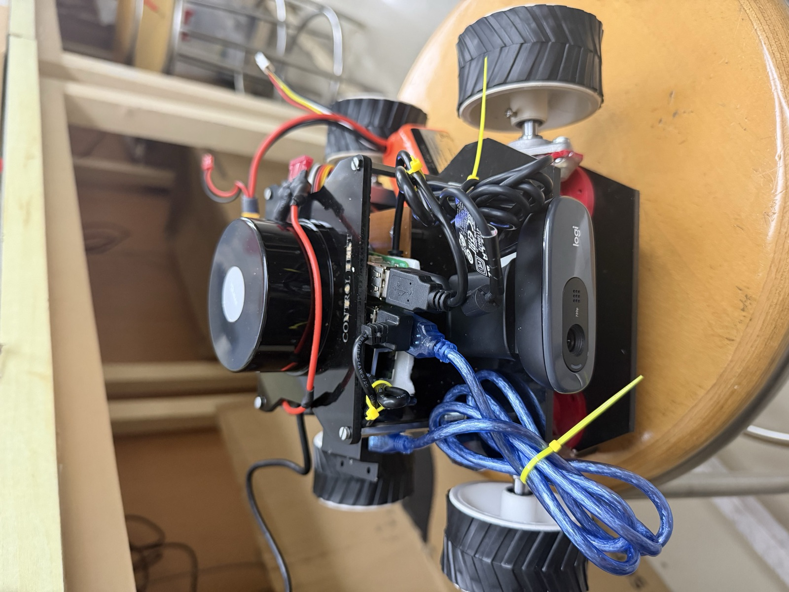
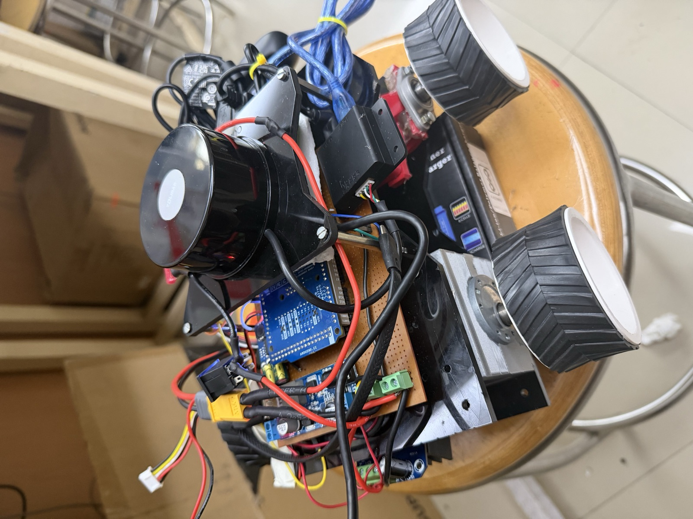
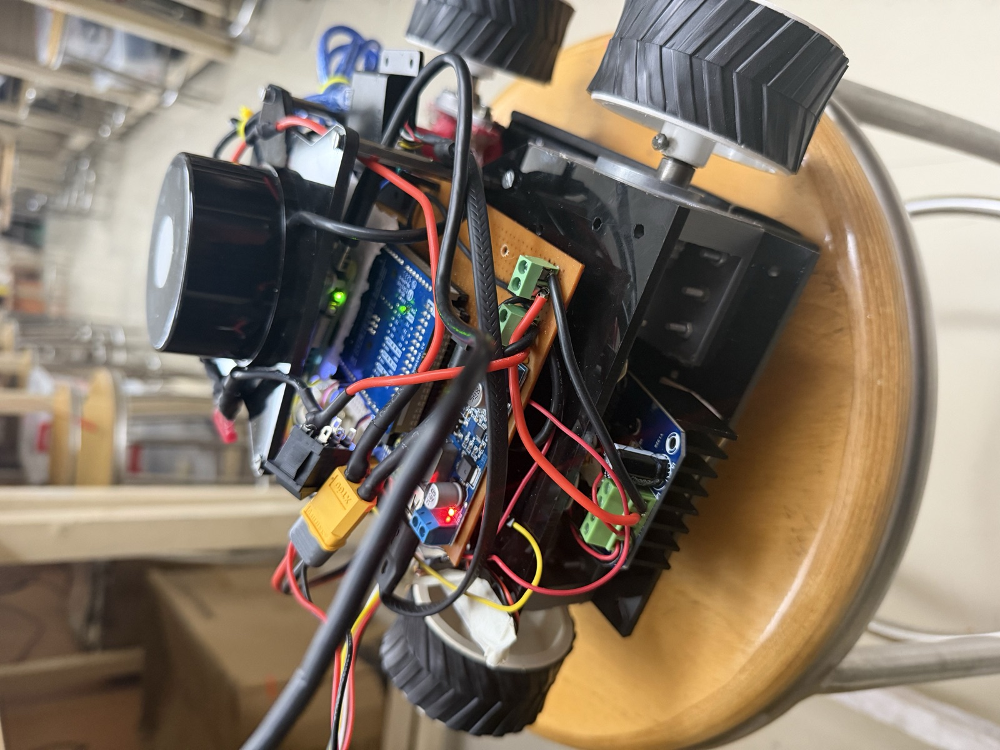
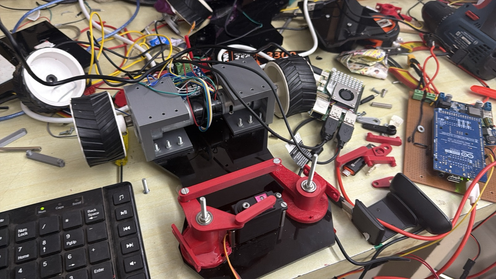

# Obstacle Avoidance and Target Following AGV

I built a small car-like robot that finds a moving yellow ball, follows it, and stops about
30 cm behind it, while steering around anything its lidar sees. The ball sits on top of an
RC car that someone drives around, so the target never stays still.

It runs ROS 2 Jazzy on a Raspberry Pi, with an Arduino GIGA R1 handling the motor and steering.

<p align="center">
  
  
  
</p>
<p align="center">
  
</p>
<p align="center"><em>Front, top and side of the robot, and the chassis during assembly with the servo steering linkage (red) and the rear drive motor.</em></p>

## What it does

1. **Looks for the ball.** If the camera can't see it, the robot drives a circle where there's
   room, then heads toward the most open part of the room and circles again.
2. **Follows it.** Once it spots the ball it drives toward it, aiming slightly ahead because the
   ball keeps moving. If the ball drops out of the camera's narrow view for a moment, a Kalman
   filter predicts where it went and the robot keeps going.
3. **Avoids obstacles the whole time.** Every move is checked against the lidar scan, so it
   steers left or right around things instead of driving into them.
4. **Stops 30 cm behind the ball,** with its wheels pointed at it, and sets off again when the
   ball moves away.

## Hardware

| Part | What I used |
|---|---|
| Main computer | Raspberry Pi 5 (also tested on a Pi 4), Ubuntu 24.04, ROS 2 Jazzy |
| Motor controller | Arduino GIGA R1 over USB |
| Drive | One DC gear motor through a BTS7960 driver (pins 5, 6, 7, 8) |
| Steering | Servo on pin 9 driving a 3D-printed linkage |
| Encoder | Channel A on pin 2, 2340 counts per wheel turn |
| Lidar | YDLidar TG15 |
| Camera | Logitech C270 webcam, 640×480 |
| IMU | MPU6050 (fitted, not used yet) |

Measured from the middle of the rear axle: wheelbase 14 cm, front bumper 20.5 cm, rear bumper
4.5 cm, width 28 cm. The lidar is 8 cm forward, the camera 20.5 cm.

## How the code is split

```
 Webcam ──► ball_detector ──/ball──────────┐
                                           ├──► follower ──/cmd_vel──► base_driver ──USB──► GIGA ──► motor + servo
 YDLidar ─► lidar driver ────/scan─────────┤                                ▲                   │
                                           │                                └───── /odom ◄──────┘ (encoder)
            base_driver ──────/odom────────┘
```

- **[`firmware/agv_base`](firmware/agv_base/agv_base.ino)**: runs on the GIGA. Speed control from
  the encoder (PI with feed-forward), steering servo, and safety: it stops the motor if commands
  stop for 300 ms or if the wheel stalls.
- **[`base_driver.py`](src/agv_follower/agv_follower/base_driver.py)**: talks to the GIGA and
  works out the robot's position (x, y, heading) from the encoder and steering angle.
- **[`ball_detector.py`](src/agv_follower/agv_follower/ball_detector.py)**: finds the yellow ball
  by colour. Distance comes from how big the ball looks. It also serves a live camera view at
  `http://<pi-ip>:8080`.
- **[`tracker.py`](src/agv_follower/agv_follower/tracker.py)**: Kalman filter that tracks the
  ball's position and speed.
- **[`follower.py`](src/agv_follower/agv_follower/follower.py)**: decides how to drive.

All the numbers (sizes, calibration, tuning) are in
[`config/agv.yaml`](src/agv_follower/config/agv.yaml).

### How it picks where to drive

The robot steers like a car, so it can only drive along curves. About 20 times a second, the
follower tries around 19 steering curves and, for each one, slides the robot's outline along it
to see if it would touch any lidar point. Curves that hit something are dropped. Of the rest, it
picks the one that:

- gets closest to the ball,
- stays furthest from obstacles,
- doesn't change the steering too suddenly,
- and doesn't drive into a spot where it couldn't turn away afterwards (it can't reverse yet).

Speed is always kept low enough to stop before the first obstacle on the chosen curve.

## Tuning it in simulation

There are a lot of settings (how much to avoid obstacles, search speed, how long to trust the
ball's last position, and so on), and tuning them by hand on the real robot was slow. So I wrote a
fast simulator ([`tools/learn`](tools/learn)) that runs the same `follower.py` without ROS, in
random rooms with obstacles, and a learner that tries different settings and keeps whatever
scores best.

The score rewards staying close behind the moving ball and catching it quickly, and heavily
penalises hitting an obstacle or driving into the ball's car. The rooms include easy open ones
and hard ones: obstacles right in the way, a wall with one narrow gap, and clutter.

```bash
cd tools/learn
python3 evaluate.py --rooms 100     # score the current settings
python3 tune.py                     # run the learner (takes a while), saves best_params.yaml
```

There is also a slower simulator in [`tools/sim`](tools/sim) that runs the full ROS setup on the
Pi for a last check before trying things on the robot.

## Calibration

Scripts in [`tools`](tools), run on the Pi:

- `steer_calib.py`: find the servo angle for straight wheels and the steering limits
- `motor_calib.py`: find the power needed to start moving and tune the speed loop (wheels off the ground)
- `lidar_calib.py`: work out which way the lidar faces
- `camera_calib.py`: check distance and direction to the ball

## Running it

From my laptop, copy the code to the Pi and build it:

```bash
./deploy.sh            # copy + build
./deploy.sh flash      # also upload the GIGA firmware
```

On the Pi:

```bash
source ~/agv_ws/env.sh
ros2 launch agv_follower bringup.launch.py                  # everything
ros2 launch agv_follower bringup.launch.py follow:=false    # sensors and motors only
ros2 param set /follower enabled false                      # stop following
```

## Problems I ran into

- **The Pi kept resetting.** It browned out whenever the lidar, camera and motor were all running.
  It needs its own 5 V supply (5 A for a Pi 5, 3 A for a Pi 4) rather than sharing a weak one.
- **The lidar was mounted rotated and mirrored.** Its zero angle points about 135° away from the
  front and its angles run clockwise. I only found this by driving the robot and comparing
  scans before and after.
- **The steering turns much less than the servo.** The linkage gives only about 11° at the wheels,
  so the robot turns on a circle about 1.4 m across. That's the main limit on how well it avoids
  things.
- **Reverse is weak.** Backwards runs much slower than forwards, so reverse is switched off
  (`allow_reverse: false`) until I fix the motor wiring.
- **The camera's view is narrow** (about 38°), so the ball easily leaves it while the robot is
  turning. The tracker covers short gaps.
- **The lidar only sees at its own height.** Thin netting and low things, including the RC car
  under the ball, are invisible to it.

## Folder layout

```
firmware/agv_base/       GIGA firmware
src/agv_follower/        ROS 2 package (nodes, config, launch, tests)
tools/                   calibration scripts
tools/sim/               ROS simulator for the Pi
tools/learn/             fast simulator and tuning
docs/images/             photos
deploy.sh, flash_firmware.sh, env.sh
```
